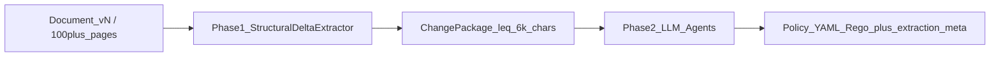

# Targeted Extraction Pipeline

## Overview

This document describes the architectural change from **full-document prompt stuffing** to a **two-phase targeted extraction pipeline**:

1. **Phase 1 — Deterministic filter (offline / sync):** Structural and entity diffs produce a bounded `ChangePackage` with **no LLM calls**.
2. **Phase 2 — LLM agents (OpenRouter):** Policy Writer, Compliance, and Security reason **only** over the `ChangePackage` plus compact baseline inventory — never raw full-manual text.

The goal is to avoid “lost in the middle” failures on 100+ page manuals, reduce token cost and latency, and keep policy generation focused on what actually changed.

---

## Problem (before)

Previously, policy generation built LLM context by stuffing document body into prompts:

| Location | Behavior |
|---|---|
| `DocumentIngestionService.buildContextSummary` | Included `fullText` up to **10,000** characters |
| `PolicyGenerationAgent.buildGenerationPrompt` | Embedded another **~3,000** characters of body under “DOCUMENT CONTENT SUMMARY” |
| Analysis / delta | Line and control diffs existed, but were **metadata only** — not the primary LLM input |

This scaled poorly for large manuals: high cost, high latency, and weak attention on the true deltas (new controls, changed sections).

---

## Solution architecture



### Pipeline stages (runtime)

`agentManager.generatePolicy` emits:

| Stage | Role |
|---|---|
| `deterministic-filter` | Resolve / refresh `ChangePackage` via Analysis Agent → `StructuralDeltaExtractor` |
| `policy-writer` | OpenRouter (or demo fallback) drafts YAML from ChangePackage-shaped prompts |
| `compliance` | Validate policy with framework + risk matrix + `changePackage` |
| `security` | Risk analysis with `changePackage` in context |
| merge | Combine results; attach Rego, `extraction`, `pipeline` |

Full-text fields are explicitly stripped from `documentContext` before Phase 2.

---

## ChangePackage data contract

Produced by `backend/src/services/StructuralDeltaExtractor.js` and stored on the document record as `document.changePackage`.

```js
{
  documentId,
  familyId,
  previousDocumentId?,      // set in delta mode
  previousVersion?,
  currentVersion?,
  mode: 'delta' | 'baseline',
  hasDelta: boolean,
  stats: {
    prevChars,
    currChars,
    addedLines,
    removedLines,
    tokenEstimate          // ~chars/4 of capped package
  },
  addedControls: [{ id, description, section? }],
  removedControls: [{ id, description? }],
  addedRisks / removedRisks / addedRequirements,
  changedSections: [{
    heading,
    beforeSnippet?,        // capped
    afterSnippet,
    changeType             // added | removed | modified
  }],
  stableInventory: {
    controlIds: [],        // IDs only — no prose dump
    riskIds: []
  },
  rawExcerptsMaxChars: 4000,
  packageChars,            // serialized size after trim
  truncated?               // true if trimmed to fit budget
}
```

### Hard caps (enforced in code)

| Constant | Value | Purpose |
|---|---|---|
| `LLM_PACKAGE_MAX_CHARS` | **6000** | Max serialized package size for LLM-bound context |
| `RAW_EXCERPTS_MAX_CHARS` | **4000** | Cap on excerpt material inside the package |
| Snippet length | **~280** (progressively shortened on overflow) | Keep section diffs readable but bounded |

If the package exceeds 6k characters, `trimPackage` shortens snippets and drops excess changed sections until it fits.

### Modes

| Mode | When | Contents |
|---|---|---|
| `baseline` | First version in a document family (no prior) | Structured extract: controls / risks / requirements + section outline — **not** a body dump |
| `delta` | Prior family version exists | Added/removed entities, changed section snippets, stable ID inventory |

---

## Phase 1 — Deterministic filter

### Core module

**`backend/src/services/StructuralDeltaExtractor.js`**

Responsibilities:

1. **Section split** — headings matched by `Section N:`, Markdown `#`, or ALL-CAPS title lines.
2. **Section diff** — compare by heading identity; within section, produce capped before/after snippets.
3. **Entity diff** — control IDs, risks, requirements from `DocumentParser` / fixture `extracted` structures.
4. **Package build** — `buildBaselinePackage` or `buildDeltaPackage`, then `trimPackage`.

Public API:

- `extractChangePackage(currentDoc, previousVersion?)`
- `summarizeChangePackage(pkg)` — compact counts for API/UI (no large snippets)
- `splitSections(rawText)`

### Wiring on ingest

| Component | Behavior |
|---|---|
| `DocumentIngestionAgent` | After parse, resolves previous family version → `extractChangePackage` → stores `doc.changePackage` |
| `seedSynthetic.js` | Seeds v1 (baseline) and v2 (delta vs v1) packages for `synth-doc-family-cloud-manual` |
| `AnalysisAgent` (`task: 'delta'`) | Prefers cached `changePackage`; otherwise computes and caches it. Returns package + `hasDelta` + `packageSummary` |

Document families and versions live in the synthetic store (`documentVersions` map + `familyId` on each doc).

---

## Phase 2 — LLM on ChangePackage only

### Context summary

**`DocumentIngestionService.buildContextSummary`**

- Ensures a `changePackage` exists (compute on demand if missing).
- Returns `changePackage`, `extraction` summary, delta-focused or baseline lists, `stableInventory`.
- **Does not** include `fullText`.

### Prompt construction

**`PolicyGenerationAgent.formatChangePackageForPrompt` / `buildGenerationPrompt`**

Prompt sections emphasize:

- ADDED / REMOVED controls and risks  
- CHANGED sections (capped snippets)  
- STABLE inventory (IDs only)  
- Explicit instruction: reason only over the package; do not invent unseen pages  

The old `DOCUMENT CONTENT SUMMARY` body dump is removed.

### Agent orchestration

**`agentManager.generatePolicy`**

1. Run `deterministic-filter`  
2. Strip any residual `fullText`  
3. Pass `documentContext` (with `changePackage`) into policy generation  
4. Pass `changePackage` into compliance / security tasks  
5. Attach observability fields on the final policy:

```js
finalPolicy.extraction = {
  mode,                    // 'baseline' | 'delta'
  hasDelta,
  stats,
  packageChars,
  addedControls,           // counts
  removedControls,
  addedRisks,
  changedSections,
  openRouterLatencyMs,
  fullTextOmitted: true
};
finalPolicy.changePackage = changePackage;
finalPolicy.pipeline = [ /* stage events */ ];
```

### Resilience

If OpenRouter is unreachable (DNS / network), `PolicyGenerationAgent` falls back to a demo YAML template so the pipeline — including extraction metadata — still completes for local and e2e flows.

---

## Frontend observability

**`src/components/PolicyGenerator.tsx`**

When a generated policy includes `extraction`:

- Badge: **Extraction mode** (`baseline` | `delta`)
- Counts: added/removed controls, changed sections
- Package size, token estimate, LLM latency
- “Full text omitted” indicator
- Existing generation pipeline list (now includes `deterministic-filter`)

Test IDs: `extraction-summary`, `extraction-mode`.

---

## Synthetic fixtures (delta path)

Family: `synth-doc-family-cloud-manual` in `backend/src/fixtures/documents.json`

| ID | Version | Role |
|---|---|---|
| `synth-doc-manual-v1` | 1 | Baseline inventory |
| `synth-doc-manual-v2` | 2 | Delta vs v1 |

v2 introduces controls such as **CTRL-ENC-03**, **CTRL-IAM-03**, **CTRL-MON-02**, **CTRL-NET-01**, and risk **R4**, which the unit tests assert appear in `addedControls` / `addedRisks`.

---

## API surface

### Document context (LLM-bound shape)

```http
GET /api/documents/:id/context
Authorization: Bearer demo-token
```

Response `data` includes `changePackage` and `extraction`; **`fullText` is absent**.

### Policy generate

```http
POST /api/policies/generate
Content-Type: application/json

{
  "service": "AWS S3",
  "requirements": { "environment": "production", "compliance": "CIS", ... },
  "documentId": "synth-doc-manual-v2"
}
```

Response `data` includes:

- `policy` / structured fields / optional `rego`
- `extraction.mode` (`delta` for v2)
- `changePackage`
- `pipeline` stages including `deterministic-filter`

---

## File map

| Path | Change |
|---|---|
| `backend/src/services/StructuralDeltaExtractor.js` | **New** — Phase 1 extractor |
| `backend/src/services/StructuralDeltaExtractor.test.js` | **New** — unit fixture tests |
| `backend/src/agents/AnalysisAgent.js` | Delegates delta to extractor; returns `changePackage` |
| `backend/src/agents/DocumentIngestionAgent.js` | Computes/stores package on ingest |
| `backend/src/services/DocumentIngestionService.js` | ChangePackage-only context summary |
| `backend/src/agents/PolicyGenerationAgent.js` | ChangePackage prompts; no body dump |
| `backend/src/agents/agentManager.js` | Two-phase pipeline + extraction metadata |
| `backend/src/fixtures/seedSynthetic.js` | Seeds packages for v1/v2 |
| `src/components/PolicyGenerator.tsx` | Extraction mode UI |
| `e2e/06-api-regression.spec.ts` | Asserts delta mode + no `fullText` |

---

## Testing

### Unit (Node test runner)

```bash
cd backend
npm test
# equivalent: node --test src/services/StructuralDeltaExtractor.test.js
```

Covers baseline mode, v1→v2 control adds, package size ≤ 6k, and absence of `fullText` in serialized package.

### API / e2e

```bash
npx playwright test e2e/06-api-regression.spec.ts
```

Asserts:

- `GET .../synth-doc-manual-v2/context` → `changePackage.mode === 'delta'`, no `fullText`
- `POST /api/policies/generate` with that document → `extraction.mode === 'delta'`, `fullTextOmitted`, pipeline contains `deterministic-filter`

---

## Design decisions and out of scope

| In scope | Out of scope (this phase) |
|---|---|
| Deterministic structural + entity filter | Vector RAG / embeddings |
| Sync package on ingest / generate | Async multi-minute offline job queue |
| Hard 6k package budget | Changing OpenRouter provider/model |
| Baseline structured extract for first upload | Replacing OpenRouter with another LLM vendor |

---

## Operational notes

- **Token / cost:** Prefer generating with `documentId` pointing at a versioned family doc so Phase 2 receives deltas, not entire manuals.
- **Logging:** `agentManager` logs `mode`, `packageChars`, `tokenEstimate`, and `openRouterLatencyMs` per generate.
- **Auth:** Demo flows use `demo-token`; document access allows `anonymous` / `demo-user` / `demo-user-id` for synthetic docs.
- **Restart:** After pulling these changes, restart the backend so seed attaches `changePackage` to in-memory documents.

---

## Related documentation

- [README.md](./README.md) — product overview and quick start  
- [IMPLEMENTATION_SUMMARY.md](./IMPLEMENTATION_SUMMARY.md) — broader system implementation  
- [AI_AGENT_WORKING/](./AI_AGENT_WORKING/) — layman descriptions of individual agents  
- [WIZ_INTEGRATION.md](./WIZ_INTEGRATION.md) — threat / Wiz policy decision path (orthogonal to extraction)
